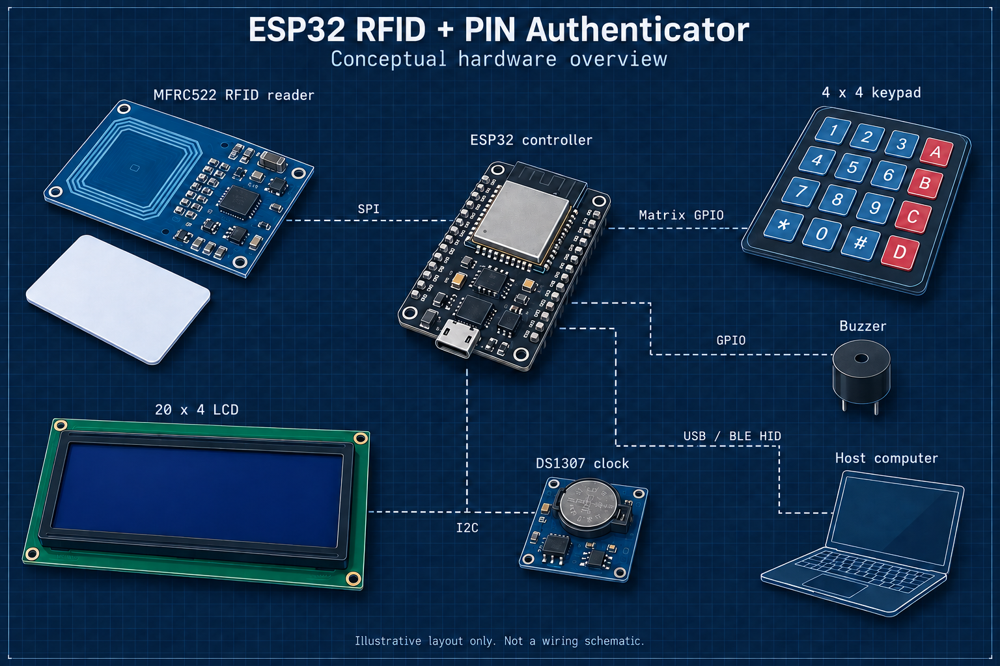
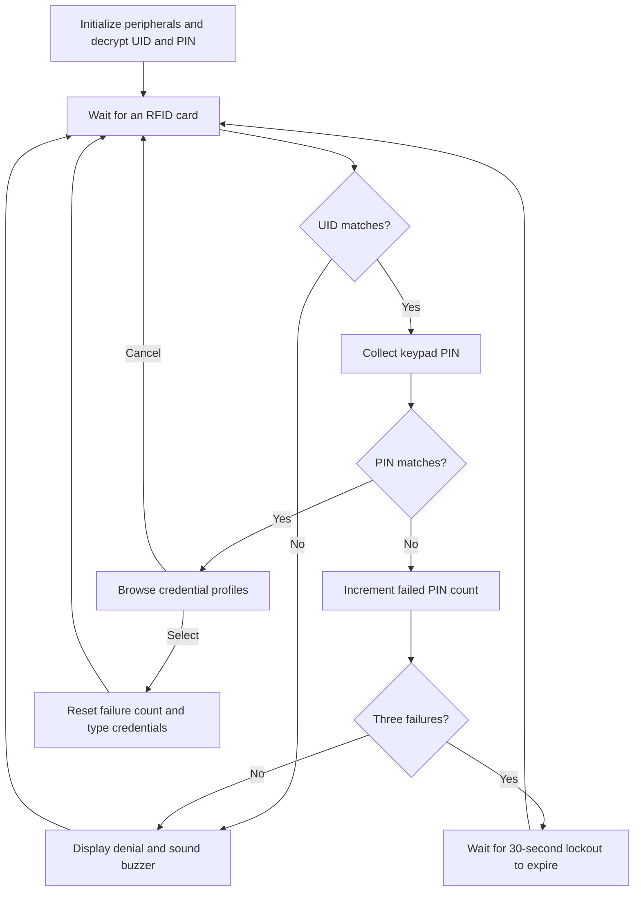

# ESP32 RFID and PIN Authenticator

An Arduino C++ prototype that checks an RFID card and keypad PIN before typing a selected username and password through a USB or Bluetooth keyboard interface.

The project combines an MFRC522 RFID reader, a 4x4 keypad, a 20x4 I2C LCD, a DS1307 real-time clock, and a buzzer. It explores peripheral integration, authentication flow, keyboard output, and timed lockout on an ESP32 platform.

The published sketch compiles for the Arduino Nano ESP32 target with the local toolchain documented in [validation notes](docs/validation.md). Physical hardware operation has not been revalidated for this release.



*Illustrated component overview, not a photograph or verified wiring schematic. Dashed links represent communication interfaces.*

## Documentation

| Guide | Contents |
| --- | --- |
| [Hardware and connections](docs/hardware.md) | Illustrated overview, bus diagram, component inventory, pin reference, and wiring worksheet |
| [Firmware architecture](docs/architecture.md) | State diagram, interaction sequence, function map, and implementation tradeoffs |
| [Validation](docs/validation.md) | Compile results, completed checks, manual test plan, and test-record template |
| [Demonstration guide](docs/demo-guide.md) | Steps for showing card rejection, PIN lockout, profile selection, and keyboard output |

## Features

- Match a scanned RFID UID against a configured value.
- Collect a PIN of up to six characters with masked LCD feedback.
- Select from four demonstration credential profiles after the card and PIN checks pass.
- Type the username, Tab, password, and Enter through the selected keyboard interface.
- Switch between USB and Bluetooth output by holding `A` for two seconds when the main loop is active.
- Lock PIN authentication for 30 seconds after three incorrect PIN submissions following an accepted card.
- Print timestamped events to the serial console using the DS1307 clock.
- Decrypt the configured UID and PIN using AES-128 at startup.

## Authentication flow



Invalid cards do not increment the PIN failure counter. The counter resets when lockout expires or a profile is selected successfully. Cancelling profile selection does not reset it.

## Repository layout

```text
firmware/
  esp32_authenticator/
    esp32_authenticator.ino
    credentials.example.h
docs/
  assets/
    hardware-overview-final.png
  architecture.md
  hardware.md
  demo-guide.md
  validation.md
```

The firmware is a sanitized copy of the original checkpoint. Personal account values have been replaced with demonstration data. Profile configuration is separated into a header, and Tab/Enter output uses character writes for the keyboard APIs.

## Hardware and pin assignments

These are the pin identifiers in the sketch, not a verified physical wiring diagram. Their GPIO mapping depends on the selected board and pin-numbering mode.

| Component signal | Sketch pin or setting |
| --- | --- |
| MFRC522 SS / SDA | `10` (SPI chip select, not I2C SDA) |
| MFRC522 RST | `9` |
| MFRC522 SCK, MOSI, MISO | Board defaults from `SPI.begin()` |
| Keypad rows, in order | `A1`, `A0`, `8`, `7` |
| Keypad columns, in order | `6`, `5`, `4`, `2` |
| Buzzer control | `3` |
| LCD | I2C address `0x27`, 20 columns, 4 rows |
| DS1307 RTC | Default I2C bus |
| Serial console | `9600` baud |

USB keyboard output needs a board with native USB device support. Both USB and BLE are initialized at startup, so the selected target must support both. An ESP32-S3 board is a suitable family to investigate; the original board model and wiring are not recorded in this checkpoint. See [Espressif's USB documentation](https://docs.espressif.com/projects/arduino-esp32/en/latest/api/usb.html) and [ESP32-S3 BLE documentation](https://docs.espressif.com/projects/esp-idf/en/latest/esp32s3/api-guides/ble/index.html).

Check pin conflicts, board voltage levels, and module pull-ups before connecting hardware. The existing pin assignments should not be copied blindly to a different board.

## Dependencies

The sketch uses the Arduino framework and these libraries. Versions below were found in the local development environment during repository preparation; they are not a guarantee of a compatible build combination.

| Library | Local version | Purpose |
| --- | --- | --- |
| [MFRC522](https://github.com/miguelbalboa/rfid) | 1.4.12 | RFID reader over SPI |
| Keypad | 3.1.1 | Matrix keypad scanning |
| [LiquidCrystal I2C](https://github.com/marcoschwartz/LiquidCrystal_I2C) | 1.1.2 | LCD output |
| [RTClib](https://github.com/adafruit/RTClib) | 2.1.4 | DS1307 timekeeping |
| [Adafruit BusIO](https://github.com/adafruit/Adafruit_BusIO) | 1.17.4 | RTClib dependency |
| [HijelHID_BLEKeyboard](https://github.com/HijelHub/HijelHID_BLEKeyboard) | 0.5.0 | Bluetooth keyboard output |
| [NimBLE-Arduino](https://github.com/h2zero/NimBLE-Arduino) | 2.5.0 | BLE stack dependency |
| [AESLib](https://github.com/suculent/thinx-aes-lib) | 2.3.6 | UID and PIN decryption |

`SPI`, `Wire`, `USB`, and `USBHIDKeyboard` come from the selected board package. Use the linked AESLib implementation, since other libraries share that name. The installed HijelHID library specifies ESP32 Arduino core 3.3.7 or newer and NimBLE-Arduino 2.3.8 or newer. See [validation notes](docs/validation.md) for the build status.

## Configuration and use

1. Open `firmware/esp32_authenticator/esp32_authenticator.ino` in Arduino IDE.
2. Select the actual board, confirm its native USB settings, and install compatible dependencies.
3. Review the pin mapping against the hardware.
4. The sketch defaults to `credentials.example.h`, containing public demonstration profiles, UID `04 A1 B2 C3`, and PIN `123456`. An arbitrary card will not match that UID.
5. To customize the configuration, copy that header to `credentials.local.h` in the same folder. The local header takes precedence and is excluded from Git. Keep experiments limited to disposable demonstration accounts.
6. The UID and PIN ciphertexts are 16-byte AES-128-CBC blocks. The example uses zero-padded ASCII, a public key, and a public IV. If either value changes, regenerate its ciphertext with the matching key and IV. Format the UID as uppercase hex bytes separated by spaces.
7. Compile before uploading. Then use the serial console at 9600 baud to inspect events. If the RTC is not running, setup initializes it from the firmware's compile date and time.
8. Test keyboard output in a disposable text field before attempting any login form. The firmware sends keystrokes to whichever application has focus and cannot verify login success.

### Controls

| Screen | Key | Action |
| --- | --- | --- |
| Main loop / idle | Hold `A` for two seconds | Toggle USB/Bluetooth output |
| PIN entry | `#` | Submit |
| PIN entry | `*` | Delete last character |
| Profile selection | `4` / `6` | Previous / next profile |
| Profile selection | `#` | Select and type |
| Profile selection | `*` | Cancel |

The PIN routine accepts other keypad characters, including letter keys, up to six characters. It is not restricted to digits.

## Prototype limitations

This is a credential-entry prototype, not a FIDO2/WebAuthn authenticator or a production password vault.

- Card verification compares a UID. It does not perform cryptographic card authentication or establish replay resistance.
- The AES key is stored with the firmware. UID/PIN encryption does not protect against firmware extraction, and profile passwords are stored as plaintext strings in firmware.
- Lockout state is held in RAM and resets on reboot. The code does not provide persistent brute-force protection.
- PIN entry and profile selection block the main loop. There is no input timeout, and mode switching is not serviced inside those screens.
- The code prints card UIDs to Serial. It does not persist an audit log.
- Startup status messages are not comprehensive peripheral health checks. The sketch does not check every initialization result or verify successful keyboard delivery.
- This repository contains no secure-boot provisioning, firmware-signing configuration, flash-encryption configuration, or documented attack-test results.

Hardware behavior must be verified on the actual wired board. See [validation notes](docs/validation.md) for completed checks and a manual test plan.
