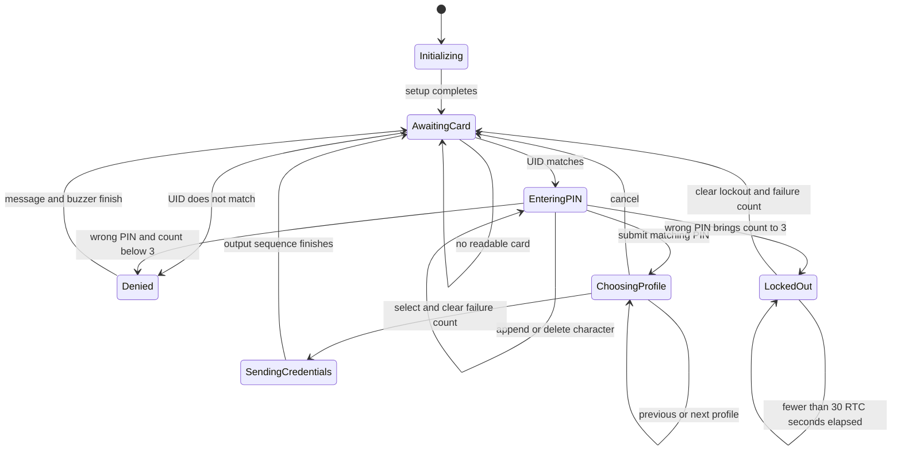
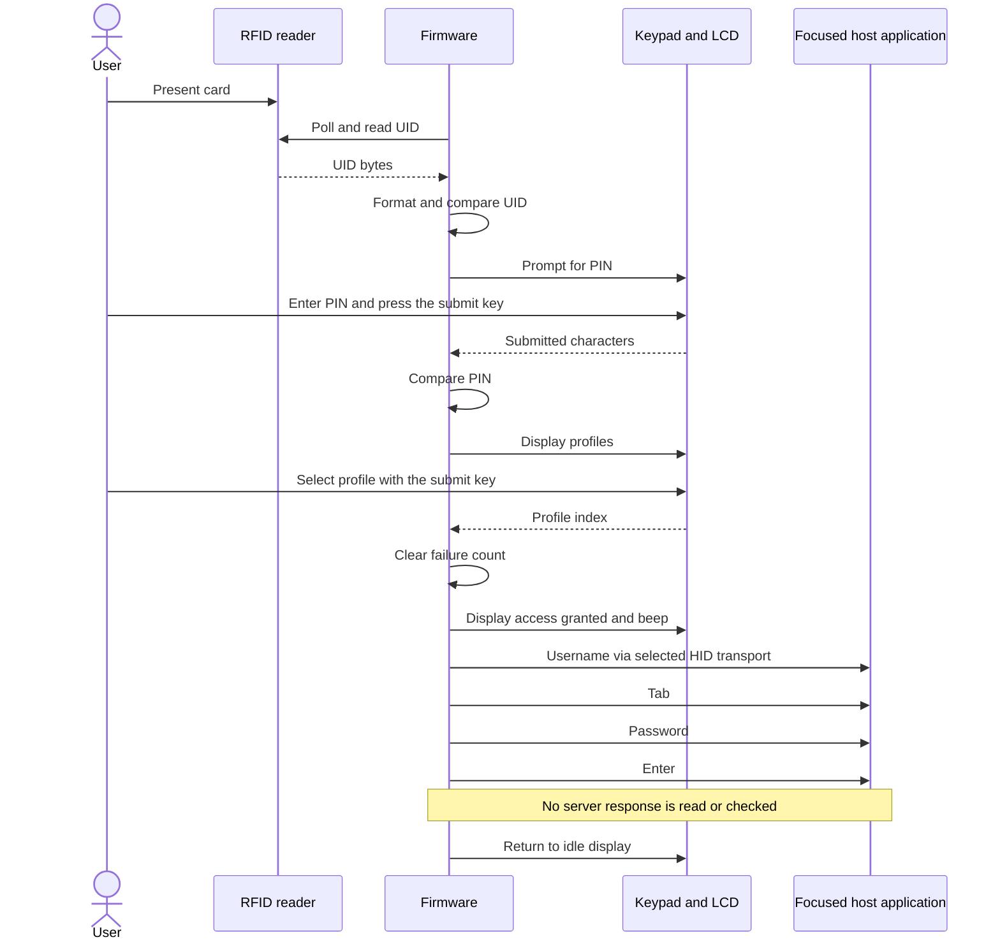
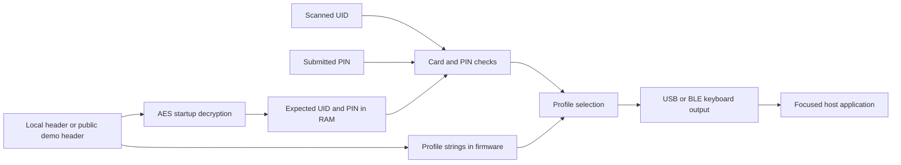

# Firmware architecture

The sketch uses one Arduino `loop()` and blocking helper functions. The states below describe its behavior; the implementation does not contain an explicit state enum, task scheduler, or nonblocking state-machine framework.

## States and transitions

On the third wrong PIN, the firmware sets `lockedOut`, records `lockoutTime`, and displays a denial message before the main loop starts displaying the countdown. No further cards are read while `lockedOut` is true. Restarting the device returns to initialization and clears the RAM-held lockout state.

USB/Bluetooth selection is a separate flag, not an authentication state. `checkModeToggle()` runs before the lockout check, so it can also run between lockout updates. It is not serviced while `getPIN()`, `selectProfile()`, or credential output is blocking.

## State to code map

All functions below are in [esp32_authenticator.ino](../firmware/esp32_authenticator/esp32_authenticator.ino).

| Behavior | Function or code location | Stored state |
| --- | --- | --- |
| Initialize peripherals and decrypt configuration | `setup()`, `decryptCredential()` | `validUID`, `validPIN` |
| Poll reader and compare UID | `loop()`, `getCardUID()` | Reader object and formatted UID |
| Collect masked PIN | `getPIN()` | Local `String pin` |
| Count wrong PINs | PIN comparison in `loop()` | `failedAttempts` |
| Enforce timed lockout | `checkLockout()` | `lockedOut`, `lockoutTime` |
| Browse profiles | `selectProfile()` | Local profile index |
| Type selected credentials | `typeCredentials()` and output helpers | Selected profile and `bluetoothMode` |
| Toggle output transport | `checkModeToggle()` | `aKeyHeld`, `aKeyHoldStart`, `bluetoothMode` |
| Show status and log events | LCD helpers, `logEvent()` | RTC time read when each event is logged |

`failedAttempts` counts incorrect PIN submissions after an accepted card. Invalid cards do not change it. A correct PIN followed by cancellation leaves the existing count unchanged; selecting a profile resets it before output begins.

## Successful interaction

The firmware waits one second after its success feedback/logging before typing. It inserts 300 ms delays between username, Tab, password, and Enter, then waits two seconds before returning to idle. Bluetooth text output also includes a 50 ms delay per character, plus any timing inside the BLE library. These are configured delays, not measured end-to-end latency.

## Configuration and data flow

The two encrypted blocks cover the expected UID and PIN only. Profile usernames and passwords are plaintext strings. A local configuration header prevents accidental Git publication of that file; it does not protect data in the compiled firmware.

## Implementation choices and tradeoffs

These are consequences of the code structure, not a reconstructed account of the original design process.

| Choice in the code | Benefit | Tradeoff |
| --- | --- | --- |
| Card check followed by PIN entry | Separates the two user interactions | UID matching is not cryptographic card authentication |
| Blocking input helpers | Keeps each screen's logic together | No timeout or background mode handling inside those helpers |
| RTC-based lockout | Uses seconds from the same clock as serial timestamps | RTC changes affect elapsed time; lockout flags still disappear on reset |
| HID credential entry | Sends input through a keyboard interface | Depends on window focus, field order, pairing, and host keyboard layout |
| Transport helper functions | Shares the profile/login sequence between USB and BLE | Both transports are initialized; selecting one does not disable the other |
| Compiled configuration | Simple startup path without filesystem provisioning | Updating profiles requires rebuilding; secrets remain in firmware |

## Follow-up work

Future changes could introduce an explicit nonblocking state machine, input timeouts, persistent attempt tracking, checked peripheral initialization, and a host/transport readiness check before output. Secure boot, flash encryption, and stronger card authentication would require their own implementation and validation. None are claimed as completed features.
