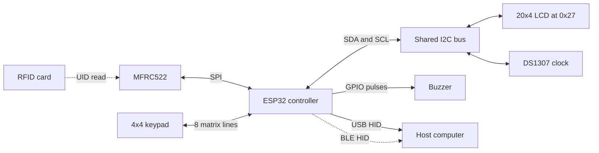

# Hardware and connection reference


This illustration approximates component appearance and shows logical communication links. It is not a photograph of the original build, a physical pinout, a PCB layout, or a verified wiring schematic. Board shape, dimensions, connector placement, and module revisions are illustrative.

## Component inventory

The firmware identifies the following components. Exact purchased modules, part revisions, power circuitry, and enclosure details are not recorded.

| Component | Quantity represented | Role in the sketch |
| --- | --- | --- |
| ESP32 controller with native USB and BLE | 1 | Runs authentication logic and keyboard transports |
| MFRC522 reader and compatible test card | 1 reader plus card | Provides the scanned UID |
| 4x4 matrix keypad | 1 | PIN entry, profile navigation, and mode selection |
| 20x4 character LCD with I2C interface | 1 | Prompts, feedback, and lockout countdown |
| DS1307 RTC module | 1 | Timestamps and lockout elapsed time |
| Buzzer | 1 | Short, success, and failure feedback patterns |
| Host computer | 1 | Receives USB or BLE keyboard input |

The code drives the buzzer with HIGH/LOW pulses rather than generating a tone frequency. The actual buzzer module and any necessary driver circuit must be identified before wiring.

## Logical bus map



These edges indicate firmware interfaces, not individual electrical nets. Power and ground are intentionally absent because the actual module supply requirements and wiring have not been established.

## Connections established by the sketch

| Device terminal or function | Controller identifier | Evidence |
| --- | --- | --- |
| MFRC522 SS, sometimes labeled SDA on the module | `10` | `SS_PIN` |
| MFRC522 reset | `9` | `RST_PIN` |
| MFRC522 SCK | Selected board's default SPI SCK | `SPI.begin()` without arguments |
| MFRC522 MOSI | Selected board's default SPI MOSI | `SPI.begin()` without arguments |
| MFRC522 MISO | Selected board's default SPI MISO | `SPI.begin()` without arguments |
| Keypad row 1 / row 2 / row 3 / row 4 | `A1` / `A0` / `8` / `7` | `rowPins` |
| Keypad column 1 / column 2 / column 3 / column 4 | `6` / `5` / `4` / `2` | `colPins` |
| Buzzer control | `3` | `BUZZER` |
| LCD and RTC SDA | Selected board/library I2C default | No explicit I2C pin override |
| LCD and RTC SCL | Selected board/library I2C default | No explicit I2C pin override |

The keypad layout is:

```text
       C1  C2  C3  C4
R1      1   2   3   A
R2      4   5   6   B
R3      7   8   9   C
R4      *   0   #   D
```

The physical connector order must be checked against the actual keypad. A ribbon cable's pin order cannot be inferred from this matrix alone.

## Information needed for an electrical schematic

- Exact board model and selected pin-numbering mode.
- Physical header pin to GPIO mapping, including SPI and I2C defaults.
- Module supply voltages and logic levels, particularly I2C pull-up voltages.
- Actual power source, common ground connections, current budget, and decoupling.
- Buzzer type and whether it needs a driver transistor.
- LCD backpack and RTC module details, including RTC battery/charging circuitry.
- Native USB connector selection and any conflicts with pins already assigned to peripherals.

The successful Nano ESP32 compile establishes software compatibility for one target. It does not establish that this board was used in the original build or that the existing pin assignments are electrically valid for it.

## Wiring verification worksheet

Complete this from the actual board and module documentation before drawing a physical wiring diagram.

| Item | Current status |
| --- | --- |
| Board and revision | Not recorded |
| Pin-numbering mode | Not recorded |
| Power source and module rails | Not recorded |
| Ground connections | Not recorded |
| Verified SPI GPIO mapping | Pending board identification |
| Verified I2C GPIO mapping and pull-ups | Pending board identification |
| Keypad connector order | Pending hardware inspection |
| Buzzer driver requirements | Pending module identification |

Use the [manual test plan](validation.md#manual-hardware-checks) after the electrical connections have been verified.
