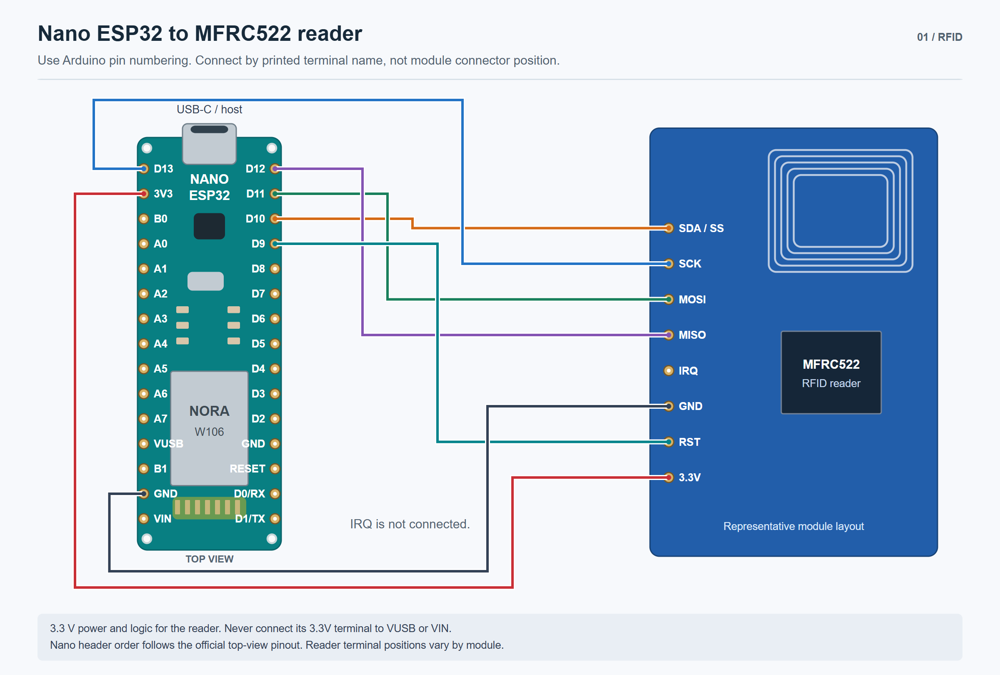
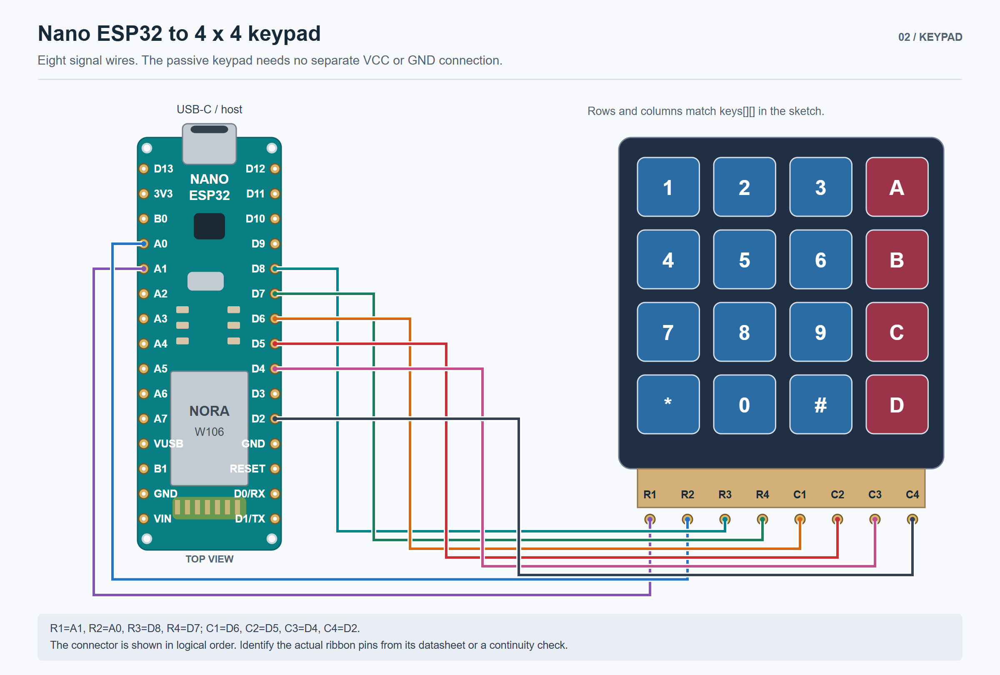
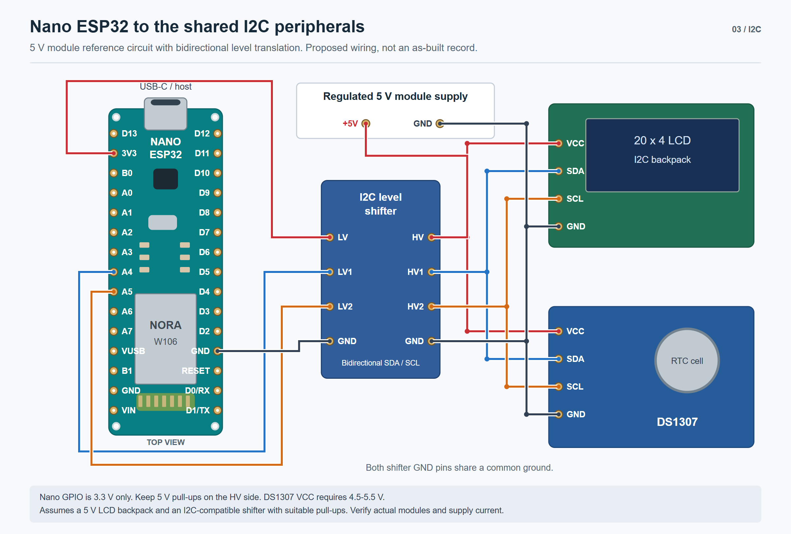
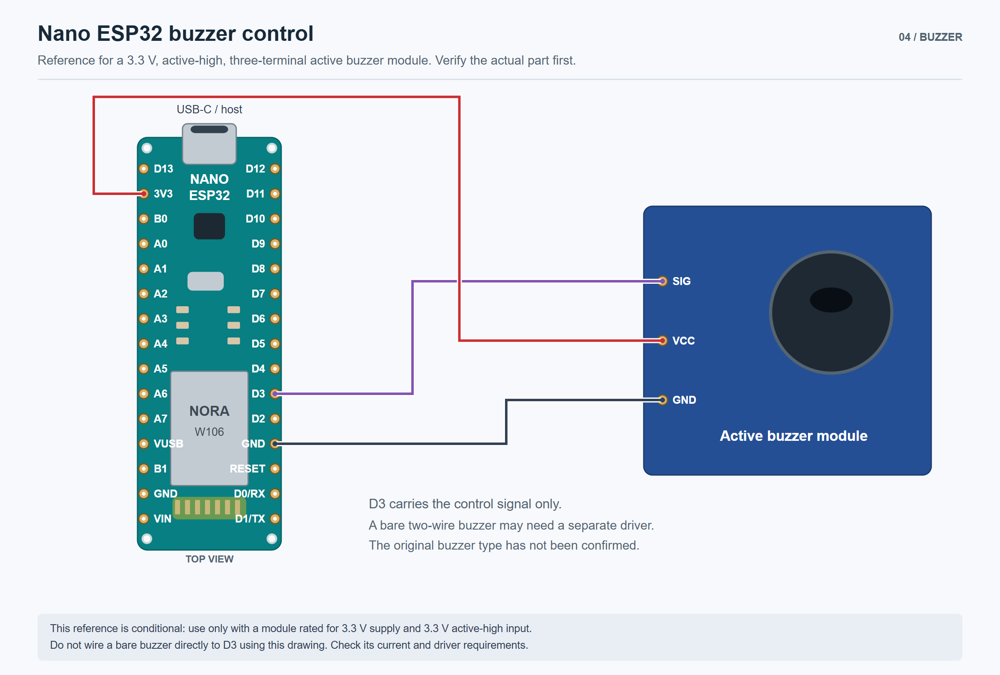
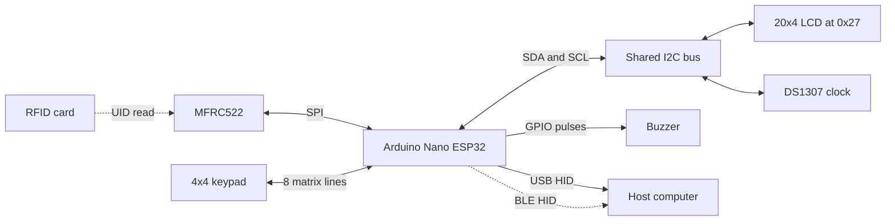

# Hardware and connection reference

The original controller is an **Arduino Nano ESP32**. Select **Tools > Pin Numbering > By Arduino pin (default)** in Arduino IDE. Numeric pin identifiers in this sketch depend on that setting.

The drawings use the Nano's physical header order, viewed from above with USB-C at the top. Each colored line connects labeled terminals. Crossings without a junction dot are separate wires. Peripheral terminal positions are representative: connect by printed terminal name and check the actual connector order.

The guides were checked against the sketch and board documentation. They have not been verified against a powered assembly or a photograph of the original wiring.

## RFID reader



[Editable SVG](assets/nano-rfid-wiring.svg)

The reader uses SPI. Its SDA terminal is chip select in this configuration, not I2C SDA. IRQ is unused. Supply the reader from 3.3 V with a common ground.

## Matrix keypad



[Editable SVG](assets/nano-keypad-wiring.svg)

The ribbon is drawn in logical row/column order. Identify the real connector pins from the keypad documentation or a continuity check. The passive keypad needs no separate supply.

```text
       C1  C2  C3  C4
R1      1   2   3   A
R2      4   5   6   B
R3      7   8   9   C
R4      *   0   #   D
```

## LCD and RTC reference circuit



[Editable SVG](assets/nano-i2c-wiring.svg)

The sketch uses SDA on A4 and SCL on A5 for both devices. The LCD is configured for 20 columns, four rows, and address `0x27`.

This is a proposed circuit for a 5 V LCD backpack and DS1307 module. The original power arrangement and backpack revision are unknown. The DS1307 requires a 4.5-5.5 V VCC supply; Nano GPIO uses 3.3 V logic. A bidirectional I2C level shifter separates the two pull-up voltage domains. Use a shifter intended for open-drain I2C with suitable pull-ups on both sides.

The Nano receives power through USB in this reference. A regulated 5 V supply powers the modules and shifter HV terminal; Nano 3V3 powers the shifter LV reference. Both sides share ground. Check module current requirements, existing pull-ups, and RTC battery/charging circuitry before assembly. Do not connect 5 V pull-ups directly to Nano GPIO.

## Buzzer reference circuit



[Editable SVG](assets/nano-buzzer-reference.svg)

The code drives D3 HIGH and LOW for feedback pulses. This drawing applies only to an active-high, three-terminal active buzzer module rated for 3.3 V supply and input. The original buzzer type is not confirmed. A bare two-wire buzzer may need a separate transistor driver depending on its current requirements; this diagram does not specify that circuit. Include the module load when checking the Nano's 3.3 V supply budget.

## Signal mapping

GPIO numbers below are for reference. Keep the sketch in Arduino pin-numbering mode.

| Device terminal | Nano label | ESP32 GPIO |
| --- | --- | --- |
| MFRC522 SS / SDA | D10 | 21 |
| MFRC522 RST | D9 | 18 |
| MFRC522 SCK | D13 | 48 |
| MFRC522 MOSI / COPI | D11 | 38 |
| MFRC522 MISO / CIPO | D12 | 47 |
| Keypad R1 | A1 | 2 |
| Keypad R2 | A0 | 1 |
| Keypad R3 | D8 | 17 |
| Keypad R4 | D7 | 10 |
| Keypad C1 | D6 | 9 |
| Keypad C2 | D5 | 8 |
| Keypad C3 | D4 | 7 |
| Keypad C4 | D2 | 5 |
| Buzzer control | D3 | 6 |
| LCD and RTC SDA | A4 | 11 |
| LCD and RTC SCL | A5 | 12 |

SPI and I2C assignments follow the Nano board defaults used by the sketch.

## Logical bus map



## Remaining hardware checks

| Item | Status |
| --- | --- |
| Board family | Arduino Nano ESP32 confirmed; exact revision not recorded |
| Pin-numbering mode | Arduino mode required; check IDE setting |
| SPI and I2C signal mapping | Checked against board variant and official pinout |
| Actual power rails, grounds, and current budget | Requires inspection |
| LCD backpack, RTC pull-ups, and level translation | Requires module identification |
| Keypad connector order | Requires inspection |
| Buzzer module and driver requirements | Requires module identification |

Use the [manual test plan](validation.md#manual-hardware-checks) after checking the electrical connections.

## References

- [Arduino Nano ESP32 official pinout](https://docs.arduino.cc/resources/pinouts/ABX00083-full-pinout.pdf)
- [Arduino Nano ESP32 pin-numbering modes](https://support.arduino.cc/hc/en-us/articles/10483225565980-Select-pin-numbering-for-Nano-ESP32-in-Arduino-IDE)
- [NXP MFRC522 datasheet](https://www.nxp.com/docs/en/data-sheet/MFRC522.pdf)
- [Analog Devices DS1307 datasheet](https://www.analog.com/media/en/technical-documentation/data-sheets/DS1307.pdf)

SVG files preserve the illustration geometry and labels for future edits. PNG copies are included for easy viewing.
