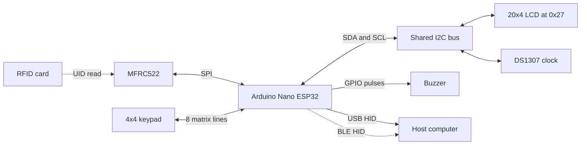

# Hardware and connection reference

The original controller is an **Arduino Nano ESP32**. Select **Tools > Pin Numbering > By Arduino pin (default)** in Arduino IDE. Numeric pin identifiers in this sketch depend on that setting.

The drawings use the Nano's physical header order, viewed from above with USB-C at the top. Each colored line connects labeled terminals. Crossings without a junction dot are separate wires. Peripheral terminal positions are representative: connect by printed terminal name and check the actual connector order.

The drawings were produced at publication time from the sketch and board documentation; they were not traced from the original breadboard. The RFID and keypad drawings match the pin assignments the prototype ran with. The I2C and buzzer drawings show recommended circuits that differ from the prototype, and each section says how.

## RFID reader


[Editable SVG](assets/nano-rfid-wiring.svg)

The reader uses SPI. Its SDA terminal is chip select in this configuration, not I2C SDA. IRQ is unused. Supply the reader from 3.3 V with a common ground.

## Matrix keypad


[Editable SVG](assets/nano-keypad-wiring.svg)

The ribbon is drawn in logical row/column order. Identify the real connector pins from the keypad documentation or a continuity check. The passive keypad needs no separate supply.

```text
       C1  C2  C3  C4
R1      1   2   3   A
R2      4   5   6   B
R3      7   8   9   C
R4      *   0   #   D
```

## LCD and RTC reference circuit


[Editable SVG](assets/nano-i2c-wiring.svg)

The sketch uses SDA on A4 and SCL on A5 for both devices. The LCD is configured for 20 columns, four rows, and address `0x27`.

**This is the recommended circuit, not the one the prototype used.** As built, the LCD and DS1307 were powered from `VIN`, and SDA/SCL ran straight to A4/A5 with no level shifter and no added pull-ups. That worked on the bench, but it leaves the bus voltage unverified on a 3.3 V part; see the limitations in the README. The DS1307 was first tried on 3.3 V and did not respond, which is consistent with its 4.5-5.5 V supply requirement.

The drawing shows the arrangement recommended for a rebuild. Nano GPIO uses 3.3 V logic, so a bidirectional I2C level shifter separates the two pull-up voltage domains. Use a shifter intended for open-drain I2C with suitable pull-ups on both sides.

The Nano receives power through USB in this reference. A regulated 5 V supply powers the modules and shifter HV terminal; Nano 3V3 powers the shifter LV reference. Both sides share ground. Check module current requirements, existing pull-ups, and RTC battery/charging circuitry before assembly. Do not connect 5 V pull-ups directly to Nano GPIO.

## Buzzer reference circuit


[Editable SVG](assets/nano-buzzer-reference.svg)

The code drives D3 HIGH and LOW for feedback pulses. **The prototype used a two-terminal active buzzer wired directly between D3 and GND**, with no transistor and no series resistor; its current draw at 3.3 V was never measured. The drawing shows the safer arrangement for a rebuild: an active-high, three-terminal active buzzer module rated for 3.3 V supply and input, so the GPIO carries only the control signal. A bare two-wire buzzer may need a separate transistor driver depending on its current requirements; this diagram does not specify that circuit. Include the module load when checking the Nano's 3.3 V supply budget.

## Signal mapping

GPIO numbers below are for reference. Keep the sketch in Arduino pin-numbering mode.

| Device terminal | Nano label | ESP32 GPIO |
| --- | --- | --- |
| MFRC522 SS / SDA | D10 | 21 |
| MFRC522 RST | D9 | 18 |
| MFRC522 SCK | D13 | 48 |
| MFRC522 MOSI / COPI | D11 | 38 |
| MFRC522 MISO / CIPO | D12 | 47 |
| Keypad R1 | A1 | 2 |
| Keypad R2 | A0 | 1 |
| Keypad R3 | D8 | 17 |
| Keypad R4 | D7 | 10 |
| Keypad C1 | D6 | 9 |
| Keypad C2 | D5 | 8 |
| Keypad C3 | D4 | 7 |
| Keypad C4 | D2 | 5 |
| Buzzer control | D3 | 6 |
| LCD and RTC SDA | A4 | 11 |
| LCD and RTC SCL | A5 | 12 |

SPI and I2C assignments follow the Nano board defaults used by the sketch.

## Logical bus map



## Hardware status

| Item | Status |
| --- | --- |
| Board family | Arduino Nano ESP32 confirmed; exact revision not recorded |
| Pin-numbering mode | Arduino mode required; check IDE setting |
| SPI and I2C signal mapping | Checked against board variant and official pinout |
| Power rails and current budget | As built: USB power, MFRC522 on 3.3 V, LCD and DS1307 on `VIN`. `VIN` voltage and total current were never measured |
| LCD backpack, RTC pull-ups, and level translation | No level shifter or external pull-ups as built. Onboard pull-ups and the backpack chip marking are unconfirmed |
| Keypad connector order | Works with rows A1, A0, D8, D7 and columns D6, D5, D4, D2. The first attempt had the order reversed and produced wrong keys |
| Buzzer | Two-terminal active buzzer driven directly from D3 as built. Current draw unmeasured |

Use the [re-test checklist](validation.md#behavior-reference-and-re-test-checklist) after checking the electrical connections on a rebuild.

## References

- [Arduino Nano ESP32 official pinout](https://docs.arduino.cc/resources/pinouts/ABX00083-full-pinout.pdf)
- [Arduino Nano ESP32 pin-numbering modes](https://support.arduino.cc/hc/en-us/articles/10483225565980-Select-pin-numbering-for-Nano-ESP32-in-Arduino-IDE)
- [NXP MFRC522 datasheet](https://www.nxp.com/docs/en/data-sheet/MFRC522.pdf)
- [Analog Devices DS1307 datasheet](https://www.analog.com/media/en/technical-documentation/data-sheets/DS1307.pdf)

SVG files preserve the illustration geometry and labels for future edits. PNG copies are included for easy viewing.
